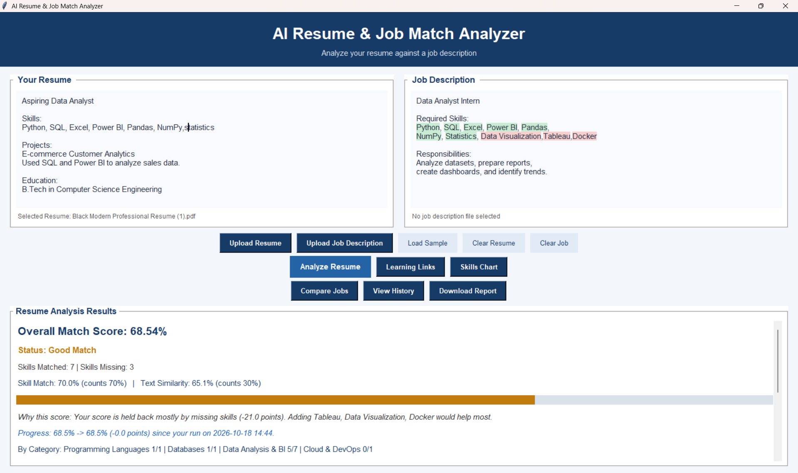
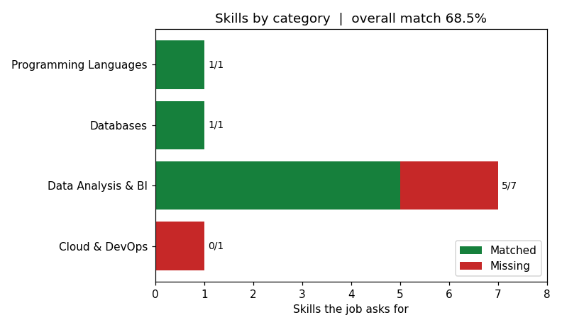
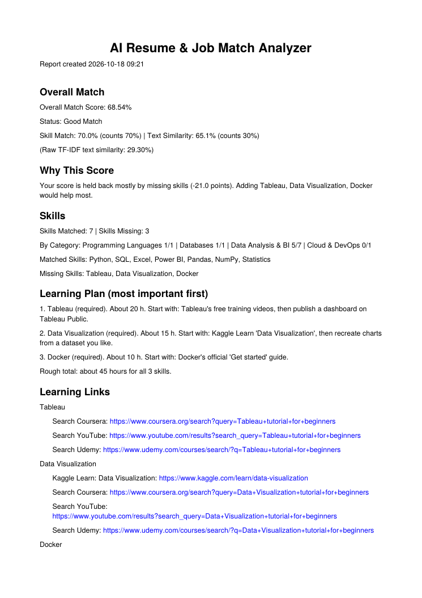

# AI Resume & Job Match Analyzer

A desktop app that compares your resume with a job description and tells you **how well you match, what is missing, and what to do about it**. Everything runs on your own computer. Your resume is never uploaded anywhere.

Built with Python, tkinter and scikit-learn.



## Download

Windows users can download the ready-to-run program from the
[latest release](https://github.com/deepak-nayak-ds/Resume-job-match-analyzer/releases/latest).

## What it does

- **Reads your files:** PDF, Word (.docx) and text resumes and job descriptions, or paste text directly. Scanned PDFs work too if OCR is installed.
- **Finds skills:** 124 skills in 8 categories (programming, databases, data and BI, machine learning, web, cloud, tools, soft skills). It understands aliases, so `ML`, `sklearn` and `PowerBI` count as Machine Learning, Scikit-learn and Power BI.
- **Scores the match:** one overall score, with a one-line explanation of what is holding it back.
- **Weights importance:** skills under a "Nice to have" heading in the job count less than required ones.
- **Shows it visually:** matched skills turn green and missing skills turn red inside the text boxes, plus a chart by category.
- **Gives a learning plan:** missing skills in priority order, with a rough time estimate, where to start, and links (hand-picked pages plus Coursera, YouTube and Udemy searches).
- **Checks the resume itself:** missing sections, no email, no numbers in the descriptions, weak openings, bad length.
- **Compares several jobs:** rank your resume against up to 20 job descriptions and see which one fits best.
- **Tracks your progress:** analyze the same job again after improving your resume and see the score change and which skills you gained. History is saved between sessions.
- **Exports:** report as PDF, Word or text; history and job rankings as CSV.

### Example output

The skills chart for a sample resume against a data analyst job:



First page of the PDF report:



## How the score works

```
Overall score = 70% x skill match + 30% x text similarity
```

- **Skill match:** required skills count 2 points and nice-to-have skills count 1. The score is the points you have divided by the total points.
- **Text similarity:** TF-IDF cosine similarity between the two texts (single words and two-word phrases). Raw similarity between two documents is naturally low, so 45% or more counts as a full 100% for this part.
- **Status:** 80% and above is Excellent, 60% and above is Good, below that Needs Improvement.

The weights and the 45% cut-off are constants at the top of `analyzer.py`, so you can change them.

## Install and run

You need **Python 3.10 or newer** (developed with 3.12). tkinter comes with the normal Windows and macOS Python installers.

```
pip install -r requirements.txt
python app.py
```

Click **Load Sample** and then **Analyze Resume** to see it work straight away.

### Optional: scanned PDFs (OCR)

A scanned PDF is a picture of a page, so it needs OCR. Install the Python packages (they are already in `requirements.txt`) and the **Tesseract program**, which is a separate download. On Windows use the installer from the UB Mannheim Tesseract page and keep the default folder (`C:\Program Files\Tesseract-OCR`). The app finds it there automatically. Restart the app afterwards.

If your Tesseract is somewhere else, set `TESSERACT_CMD` to its full path before starting the app.

## Project files

```
app.py              the window (tkinter)
analyzer.py         all the logic: reading files, skills, scoring, reports, history
skills.json         skills, categories and aliases (edit this to add skills)
resources.json      learning advice, time estimates and links per skill
tests/              automatic tests
docs/               images used in this README
requirements.txt    Python packages
build_exe.bat       builds a Windows .exe
```

## Customize it

- **Add a skill:** open `skills.json` and add it under a category. Aliases go in the list next to it:
  ```json
  "Databases": { "MariaDB": ["Maria DB"] }
  ```
  Words that are also normal English (like "excel" or "swift") go in `_case_sensitive`, so only the capitalised form matches.
- **Change learning advice:** edit `resources.json`. If a link ever stops working, just replace the URL.
- **Change the scoring:** see the constants at the top of `analyzer.py`.

## Tests

```
python -m unittest discover -s tests -v
```

60 tests cover skill matching, scoring, resume checks, file reading (encodings, damaged and password-protected files, scans), history saving, job ranking and report export. They do not open a window and do not touch your real history.

## Build a Windows .exe

Run `build_exe.bat` from the project folder. The program appears in `dist\ResumeJobAnalyzer.exe`.

Good to know:
- The first start of a one-file build takes a few seconds, because it unpacks itself.
- The file is large, because scikit-learn is included.
- Windows or your antivirus may warn about unknown programs built with PyInstaller. This is a known false alarm for new, unsigned programs.
- OCR is not included. Tesseract must be installed on the computer.
- As an .exe, history is saved in `%APPDATA%\ResumeJobAnalyzer\history.json`.
- If the .exe closes immediately, rebuild without `--windowed` in `build_exe.bat` and start it from a command prompt to see the error message.

## Known limitations

- Skills are matched by words from `skills.json`. Something like "built predictive models" will not count as Machine Learning unless you add it as an alias.
- The "nice to have" detection looks for a heading line such as "Nice to have" or "Preferred". Skills in a section placed after it count as nice to have.
- MySQL does not count as SQL. They are separate skills.
- Resume tips are rule-based and can be wrong for unusual layouts.
- Time estimates in `resources.json` are rough guesses.
- OCR quality depends on the scan, and only the first 5 pages are read.
- English only.

## Ideas for next

- A "related skills" rule (for example MySQL implies SQL)
- Semantic matching with sentence embeddings instead of exact words
- A skills file you can edit from inside the app

## About

Made by Deepak Nayak. <!-- add your LinkedIn or GitHub link -->

Add a license file (for example MIT) before you publish it, so others know how they may use it.
